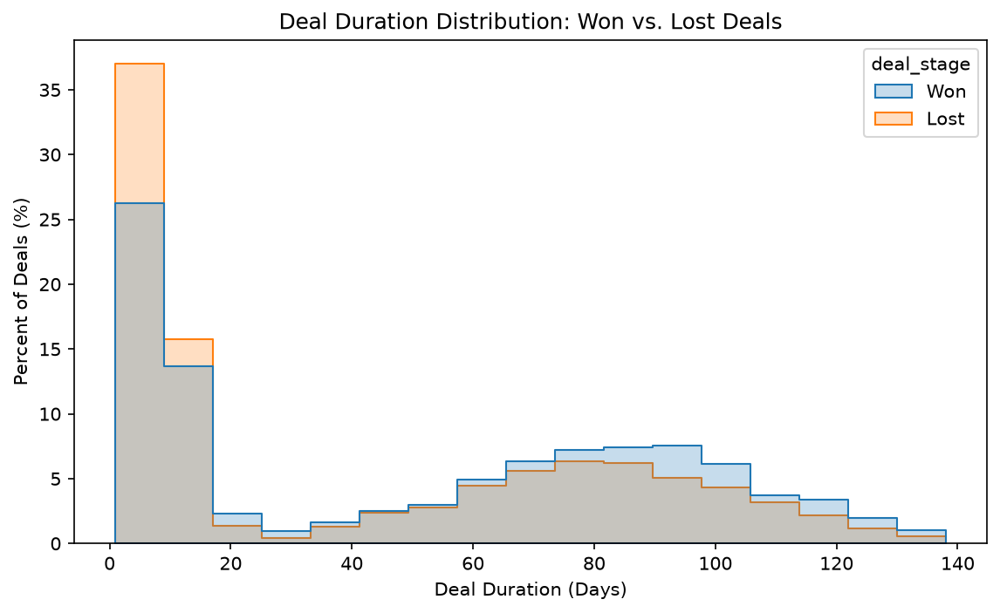

# CRM Sales Pipeline Conversion Analysis

Do customer sector and deal duration explain which B2B deals get won? This project tests two common sales-team assumptions against 6,711 closed CRM deals, using hypothesis tests and a supporting logistic regression in Python.

**Notebook:** [`analysis.ipynb`](analysis.ipynb)

## Key results

| Question | Answer |
|---|---|
| Does win rate differ across sectors? | **No detectable difference.** Win rates ranged from roughly 61% to 65% across sectors (χ² = 2.83, dof = 9, *p* = 0.97, Cramér's V = 0.021). |
| Do won and lost deals differ in deal duration? | **Yes, and in the opposite direction from the assumption.** Won deals took about 10 days longer to close on average (51.8 vs. 41.5 days; difference 10.30 days, 95% CI [8.30, 12.31]; Welch's *t* = 10.06, *p* < 0.001). A Mann-Whitney U test agreed. |
| How strong is the effect of deal duration? | **Modest.** A randomly chosen won deal took longer than a randomly chosen lost deal 57.8% of the time. Each extra day is associated with 0.63% higher odds of winning; grouped cross-validated ROC-AUC = 0.578 (± 0.013). |



**Takeaway for sales leadership:** the data give no support for prioritizing deals by sector, and a long deal duration alone is not a warning sign. Quick closes (15 days or less) were over-represented among lost deals (51% of lost deals vs. 38% of won deals), although most quick closes were still won.

## Business context

The sales operations team at a B2B computer hardware company relies on two untested assumptions: (1) some customer sectors convert at higher rates, and (2) deals that take longer to close are less likely to be won. This analysis checks both using historical closed deals.

**Research questions**

1. Does win rate differ across customer sectors?
2. Do won and lost deals differ in deal duration?

## Data

- **Source:** [CRM Sales Opportunities](https://www.kaggle.com/datasets/innocentmfa/crm-sales-opportunities/data) on Kaggle (Mursaleen Ameer). Two tables are used: `sales_pipeline` and `accounts`.
- **Scope:** 6,711 closed deals (4,238 won, 2,473 lost; 63.15% win rate), engaged from 2016-10-20 to 2017-12-31.
- **Not included:** open deals (Engaging and Prospecting). They have no outcome yet, and none of them matched an account record.

## Approach

1. **Data wrangling.** Merged the two tables (validated as many-to-one), confirmed the 1,425 unmatched rows were all open deals, kept won and lost deals only, and corrected a misspelled sector label. Added checks for unique deal IDs, valid date order, and hidden duplicate categories.
2. **Exploratory analysis.** Univariate and bivariate summaries. Deal duration is bimodal, so medians and means tell different stories, which motivated a robustness check.
3. **Hypothesis testing.** Chi-square test of independence with Cramér's V for sector; Welch's *t*-test with a confidence interval, plus a Mann-Whitney U test, for deal duration.
4. **Supporting model.** Logistic regression of outcome on deal duration, reported as an odds ratio. ROC-AUC was estimated with cross-validation grouped by account, because accounts repeat across deals.

## Limitations

- Only closed deals are analyzed, so the results say nothing about whether open deals are stagnating.
- Deal duration is only known once a deal closes and is partly shaped by the outcome (for example, quick losses). The results are descriptive and do not show that longer deals cause wins, and duration cannot be used to score open deals.
- Accounts repeat across deals, so observations are not fully independent and p-values may be somewhat optimistic.
- Results come from one dataset covering about 14 months, so they may not generalize to other periods or companies.

## Next steps

- Build a lead-score model using only features known while a deal is still open.
- Analyze open-deal age once periodic snapshot data is available.
- Investigate what distinguishes quick-closing deals (product, price, region, or sales team).

## Repository structure

```
├── README.md
├── analysis.ipynb          # full analysis, from data wrangling to findings
├── requirements.txt
├── data/
│   ├── raw/                # not tracked: download the CSVs from Kaggle (see below)
│   └── clean/              # crm_sales_cleaned.csv, generated by the notebook
└── reports/
    └── figures/
```

## How to run

1. Use **Python 3.12 or newer** (the notebook uses nested quotes inside f-strings).
2. Install dependencies:
   ```bash
   pip install -r requirements.txt
   ```
3. Download `sales_pipeline.csv` and `accounts.csv` from the Kaggle link above and place them in `data/raw/`.
4. Open `analysis.ipynb` and run all cells. The cleaned dataset is written to `data/clean/`.

## Tools

Python, pandas, NumPy, SciPy, statsmodels, scikit-learn, Matplotlib, Seaborn, Jupyter.

## Author

Alejandro Mondragon · https://www.linkedin.com/in/alejandro-mondragon-b3a48917b/ · a.mondragon11@hotmail.com